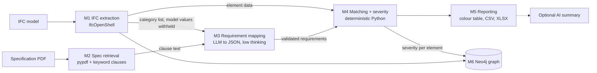

# BIM Hybrid Auditor: IFC model vs technical specification

A Streamlit app that checks elements in an **IFC (3D BIM) model** against the requirements written in a **specification PDF**, and classifies every element by **severity of mismatch**.

## 1. Module flow



| Module | File | Uses LLM? | Job |
|---|---|---|---|
| M1 IFC extraction | `check_ifc_compliance.py` | No | Find elements, read thickness, materials, storey, external flag |
| M2 Spec retrieval | `app.py` | No | Pull the relevant clauses out of the PDF |
| M3 Requirement mapping | `spec_matching.py` | **Yes (only here)** | Map each model category to the requirement in the spec, as JSON |
| M4 Matching + severity | `spec_matching.py` | No | Compare numbers and materials, assign severity |
| M5 Reporting | `app.py` | No | Colour-coded table, CSV and Excel export |
| M6 Graph store | `ifc_to_neo4j.py` | No | Store elements, relationships and audit results in Neo4j |

## 2. Strategic choices: why the app is split this way

| Choice | Reason |
|---|---|
| Separate extraction (M1), reading (M3) and judging (M4) | Each can be tested and replaced on its own, and errors can be traced to one step |
| The LLM is confined to M3 | An LLM is good at reading messy specification language but unreliable at arithmetic and consistent judgement. Comparison is therefore done in code |
| The LLM never sees the model's thickness or materials | It cannot "agree" with the model; it can only report what the specification says |
| LLM output is forced into a fixed JSON schema and validated | Free text cannot silently change a result; bad values are rejected |
| Evidence quotes are checked against the PDF text by program | Detects invented requirements |
| Neo4j stores the model and the audit results | Results can be queried (for example all Critical elements on one storey) and kept beyond one session |
| Streamlit front end, GitHub deployment | Fast to build and share, no installation for the reviewer |

## 3. Tactical choices: software and process

| Task | Tool | Why |
|---|---|---|
| Read IFC | IfcOpenShell | Standard open-source IFC library; gives property sets, materials, geometry |
| Read PDF text | pypdf | Light, pure Python. Limitation: no OCR, so scanned PDFs return no text |
| Language model | Gemini (`gemini-3.8-flash`, fallback `gemini-3.5-flash-lite`) | Large context window for specification text, JSON output mode |
| Determinism settings | low thinking setting, fixed prompts, empirical repeat tests | Gemini 3 does not support guaranteeing identical outputs; repeatability must be measured |
| Matching and severity | Plain Python functions | Same input always gives the same output; easy to unit-test |
| Tables and export | pandas + openpyxl | Colour-coded Excel and CSV |
| Graph | Neo4j (batched `UNWIND` queries) | Relationship-rich model data; one round trip per 500 rows, not per element |
| Secrets | Streamlit secrets / environment variables | No credentials in source code |

## 4. How extraction and matching work

### 4.1 IFC extraction (M1)
Elements are selected when the keyword appears in the **IFC class** (for example `IfcWall`, `IfcCurtainWall`), or in the **name** unless the class is a known false-positive source (doors, windows, furniture, railings, light fixtures, proxies).

Project units are read from the file (`ifcopenshell.util.unit`) and every length is converted to mm.

Thickness is taken from the first plausible source in this order, and the source used is recorded in the `ThicknessSource` column:

| Tier | Source | Note |
|---|---|---|
| 0 | Sum of material-layer thicknesses | The real build-up, most trusted |
| 1 | Property sets: WallThickness, OverallThickness, NominalThickness, Thickness, Width | Specific names are tried before bare "Width" |
| 2 | A number followed by "mm" in the element name or type | Weakest text-based source |
| 3 | 3D bounding box, shortest horizontal side | Only for roughly rectangular, axis-aligned elements |

A value above 600 mm is treated as implausible and the next tier is tried. If nothing plausible exists, the element is treated as **geometry missing**.

Materials are read from layer sets, constituent sets, profile sets, material lists and single materials. Only real material names are kept for matching.

### 4.2 Specification retrieval (M2)
The PDF is split into paragraphs. Paragraphs containing specific construction terms (thickness, cavity, insulation, blockwork, etc.) are kept; generic words such as "wall" are used only when their paragraphs contain a measurable requirement. If fewer than 3 paragraphs match, the full text of every page with a hit is used instead. The text is cut at a paragraph boundary at about 120,000 characters. If it is truncated, the audit is marked incomplete.

### 4.3 Requirement mapping (M3, LLM)
Model elements are grouped into categories by normalized `Name (IFC class)`; trailing numeric instance identifiers are removed so repeated wall types share a category, while IFC class and the external flag remain separate. For each category the LLM receives only the category name, IFC class and external flag, plus the specification text. It returns JSON: `spec_found`, `required_thickness_mm`, `required_materials`, `clause_reference`, `evidence_quote`.

Python then validates it: thickness must be between 0 and 2000 mm, a missing `category_id` becomes "not found", and an evidence quote must be verifiable in the extracted specification text. Unsupported requirements are rejected (not compared), although a matching quote alone is not proof of correct clause applicability.

### 4.4 Matching and severity (M4, deterministic)
- **Geometry**: ok if the model thickness is within the tolerance (default ±5 mm) of the required value; mismatch otherwise; missing if the model has no usable thickness.
- **Materials**: a required material is found if all its significant words appear in the model's material names (all layers pooled, simple plural and synonym handling). Otherwise it is listed as not found.
- Missing model data is flagged even when the specification is silent, because it is a model-quality problem on its own.

| Rank | Severity | Issue type | Colour |
|---|---|---|---|
| 1 | Critical | Geometry & material missing | Red |
| 2 | High | Geometry missing | Orange |
| 3 | High | Material missing | Orange |
| 4 | Medium | Geometry & material mismatch | Amber |
| 5 | Medium | Geometry mismatch | Amber |
| 6 | Low | Material mismatch | Light yellow |
| 7 | Info | Spec requirement not found / partially assessable | Grey |
| 8 | Pass | Compliant | Green |

Results are exported as colour-coded Excel and as CSV (with `Severity`, `IssueType`, `SeverityRank` columns).

## 5. Design questions

**Is it fully modular, given the LLM's understanding?**
Not fully, and it should not claim to be. One step, mapping a model category to a specification clause, needs language understanding and is done by the LLM. That step is isolated in one module, its input and output are logged and visible in the app (requirements table, raw JSON, evidence check), and everything after it is deterministic code.

**Is there a prompt, and could the wording change the results?**
Yes. Two wordings (A and B) are kept in `spec_matching.py` (`PROMPT_VARIANTS`). The button **Compare prompt wordings** runs both on the same input and reports the percentage of categories with an identical extracted requirement.

**How repeatable are the results?**
The Gemini 3 LLM uses the provider-recommended default temperature (not overridden) and a low thinking setting. There is no guarantee of identical outputs. The button **Run repeatability test** repeats the mapping N times on identical input and reports, per category, the share of runs that agree. Results that depend only on M1 and M4 are exactly repeatable.

## 6. Limitations
- PDF text extraction fails on scanned documents (no OCR).
- The bounding-box thickness (tier 3) is unreliable for curved or rotated walls.
- Material matching is word-based; unusual naming (for example "CMU" vs "concrete block") may be missed or reported as a mismatch.
- The graph stores results and model data; the audit itself reads directly from the IFC file, not by querying the graph.
- The Neo4j option "Clear the whole database" deletes everything in the target database; it defaults to OFF. Do not use it on a shared database.
- An LLM failure, absent specification text, no evidence-verified checkable requirements, or truncated context causes an INCOMPLETE audit; the system shows provisional model-data issues, labels any exports PRELIMINARY and skips Neo4j writes.
- Grouping by type name is heuristic: check categories with identical text but different specifications.
- A quoted evidence span verifies textual grounding, not that the requirement is correctly applied. Review significant high-severity findings manually.
- LLM variation is reduced, not eliminated; use the reliability tests to quantify it on each input.

## 7. Setup
Streamlit secrets (`.streamlit/secrets.toml`, never committed):

```toml
GEMINI_API_KEY = "..."
NEO4J_URI = "neo4j+s://<your-instance>.databases.neo4j.io"
NEO4J_USERNAME = "..."
NEO4J_PASSWORD = "..."
NEO4J_DATABASE = "..."   # optional
```

Run: `pip install -r requirements.txt` then `streamlit run app.py`
